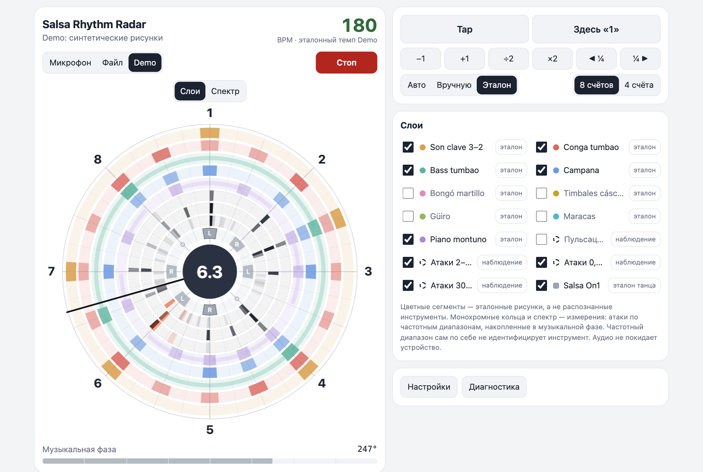
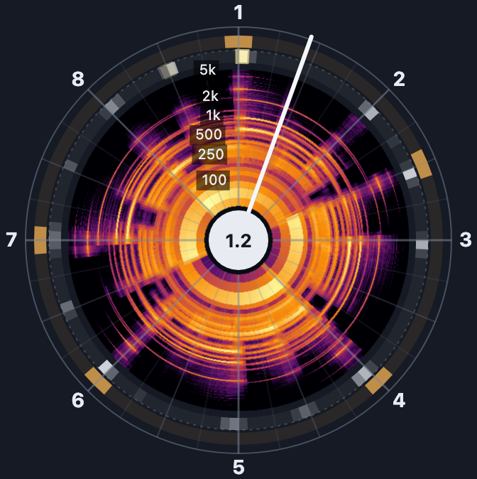
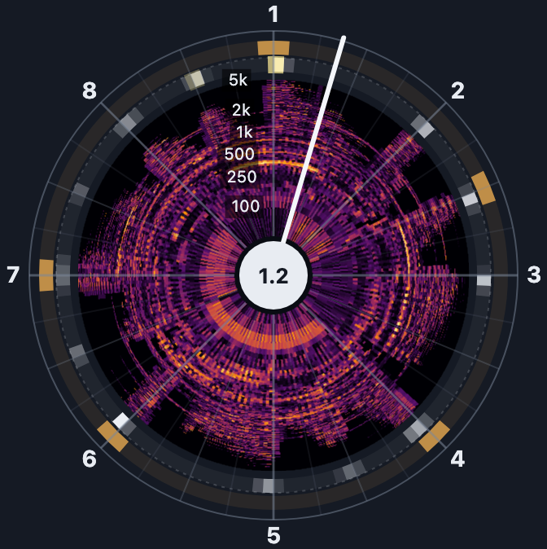
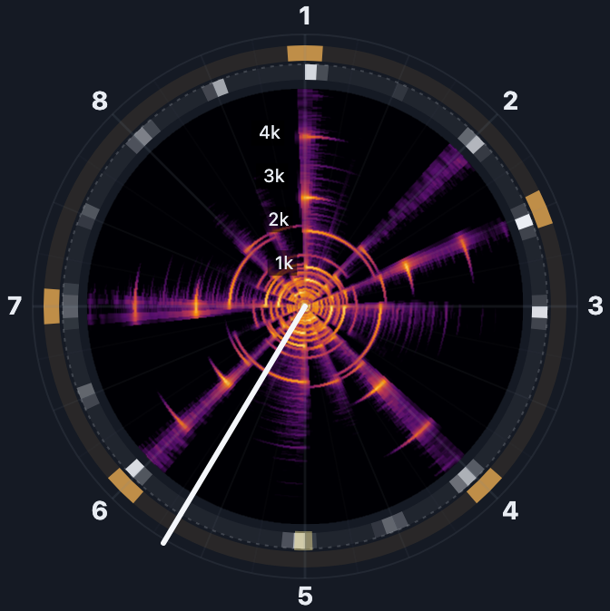

# Salsa Rhythm Radar

Исследовательское мобильное веб-приложение: слушает музыку (микрофон, файл или синтетический Demo), оценивает темп и музыкальную фазу и показывает полиритмическую структуру сальсы на круговом циферблате из восьми счетов.

Это прототип для танцоров, преподавателей и музыкантов, а не имитация анализа. Эталонные рисунки, измерения и гипотезы всегда показываются раздельно.

**🌐 Открыть онлайн:** [salsa-radar.89.124.65.229.nip.io](https://salsa-radar.89.124.65.229.nip.io) · [руководство](https://salsa-radar.89.124.65.229.nip.io/guide)



<p>



</p>

**📖 [Руководство пользователя](docs/USER_GUIDE.md)** — как читать циферблат, источники звука, темп и синхронизация, полярная спектрограмма, настройки, сценарии использования. Есть и **[автономная HTML-версия](docs/user-guide.html)**: один файл со встроенными картинками, его можно скачать, открыть офлайн или переслать.

## Что умеет (v0.3: MVP 1 + MVP 2, часть MVP 3)

- **Циферблат на 8 счетов** (два такта 4/4). Счёт 1 сверху, время идёт по часовой стрелке, один счёт = 45°. Стрелка движется по музыкальной фазе. Есть режим цикла на 4 счёта.
- **Эталонные слои** (цветные сегменты): Son/Rumba clave 3–2 и 2–3, conga tumbao, bass tumbao, campana, bongó martillo, timbales cáscara, güiro, maracas, piano montuno. Каждый рисунок снабжён источником и статусом достоверности ([docs/PATTERNS.md](docs/PATTERNS.md)).
- **Танцевальные схемы:** Salsa On2 (Eddie Torres) — основная, On1, Casino, Son (contratiempo).
- **Анимация шагов ведущего:** стопы движутся к счёту, вспыхивают при постановке и гаснут; опорная нога закрашена, брейки выделены.
- **Наблюдаемые слои** (монохромные): атаки в диапазонах 30–200 Гц, 0,2–2 кГц и 2–10 кГц, накопленные в музыкальной фазе без жёсткой квантизации, с экспоненциальным забыванием (1/4/8/16/32 цикла).
- **Полярная спектрограмма:** сонограмма, развёрнутая по циферблату. Угол — фаза в восьмёрке, радиус — частота (линейная или логарифмическая шкала, начало оси на радиусе r₀). Есть три режима накопления по восьмёркам:
  - **Мощность** — фазо-синхронное усреднение |X|²;
  - **Когерентное** — комплексное усреднение X: остаётся только то, что повторяется с той же формой волны;
  - **Когерентность** — отношение |ΣX|² / Σ|X|², от 0 до 1.
- **Автоматический темп, фаза и «1»:** иерархическая свёртка целой восьмёрки (epoch folding — «лента, свёрнутая в трубку»): верный темп за ~4 с даже на одном клаве. Фаза и «1» определяются по скелету сальсы. PLL плавно скользит по темпу и поворачивает «1» без скачков. Исследование — [docs/research/TEMPO.md](docs/research/TEMPO.md).
- **Понятная уверенность:** «надёжно · чёткость ×8» — во сколько раз ритм чётче шума, плюс отрыв от второй гипотезы темпа.
- **Люминофор (по умолчанию):** спектрограмма гаснет как экран ЭЛТ — при каждом проходе стрелки точка сдвигается на 1/N к новому значению, замолчавший инструмент исчезает за ~3N восьмёрок.
- **Лента (опция):** хранится история звука, картинка заново сворачивается и следует за PLL, а не стирается. Режимы: «Перематывать» текущим темпом (по умолчанию) или «Фаза записи».
- **Адаптивная глубина:** на стабильном ритме накладывается до 6 восьмёрок (точность), при смене темпа — 1,5 (перестройка ~4 с). Точный период и фаза уточняются по моментам атак: на синтетике ±0,01 BPM и ~1 мс.
- **Ручные инструменты:** Tap Tempo, «Здесь 1», ±1 BPM, ×2 и ÷2, сдвиг фазы на ¼ доли, режимы синхронизации «Авто», «Вручную» и «Эталон» (в Demo — истинный темп синтезатора).
- **Диагностика:** гипотезы темпа с оценками, ошибка фазы против эталона в мс (Demo), нагрузка анализа, задержки, счётчики атак.
- **Карточка слоя по нажатию:** что это за данные, источник эталона, корреляция эталона с наблюдаемыми атаками.
- PWA (установка на домашний экран, офлайн после первой загрузки), светлая и тёмная темы, русский язык с поддержкой локализации.

Аудио обрабатывается только на устройстве и никуда не отправляется.

## Быстрый старт

```bash
npm install
npm run dev        # http://localhost:5173 — микрофон работает на localhost без HTTPS
npm test           # 39 тестов: DSP, свёртка, эталоны, шаги, сквозные метрики трекера
npm run build      # проверка типов + production-сборка в dist/
npm run bench      # таблица метрик трекера на синтетике (docs/EXPERIMENTS.md)
npm run demo-wav -- out.wav 180 3-2 30   # синтетический WAV для режима «Файл»
```

Чтобы открыть приложение с телефона, нужен HTTPS: браузеры дают доступ к микрофону только на защищённых страницах. Подойдёт GitHub Pages (сборка с `base: './'` к этому готова) или туннель к dev-серверу.

## Как читать циферблат

| Что видно | Что это значит |
|---|---|
| Цветной сегмент | Удар **эталонного** рисунка, а не распознанный инструмент. Яркость — относительная интенсивность, прозрачность — статус источника. |
| Бледный хвост | Длительность звука (бас, пианино, скрежет гуиро). |
| Обводка | Событие, которое происходит сейчас (стрелка внутри сегмента). |
| Монохромное кольцо с пунктиром | **Измерение**: плотность атак в диапазоне частот. Прозрачность — уверенность синхронизации: без захвата темпа фаза атак не имеет смысла. |
| Вспышка на монохромном кольце | Атака, обнаруженная только что. |
| Серые блоки внутри | Эталонная танцевальная схема; брейк выделен обводкой, пауза — кружком. |
| Спектр | Энергия (или когерентность) спектра в данной фазе цикла, усреднённая по восьмёркам. |

Частотный диапазон сам по себе не идентифицирует инструмент.

## Документация

- [docs/USER_GUIDE.md](docs/USER_GUIDE.md) — руководство пользователя со скриншотами.
- [docs/user-guide.html](docs/user-guide.html) — то же руководство одним HTML-файлом (картинки внутри). Собирается из `docs/user-guide.src.html` командой `npm run guide`.
- [docs/DEPLOY.md](docs/DEPLOY.md) — публикация на VDS (`scripts/deploy.sh`, Caddy).
- [ARCHITECTURE.md](ARCHITECTURE.md) — модули, потоки данных, часы и временные базы, математика накопления.
- [ROADMAP.md](ROADMAP.md) — этапы MVP 1–4 и статус.
- [CLAUDE.md](CLAUDE.md) — инженерные принципы и соглашения для разработки.
- [docs/PATTERNS.md](docs/PATTERNS.md) — проверка музыкальной корректности эталонов, источники.
- [docs/EXPERIMENTS.md](docs/EXPERIMENTS.md) — метрики, находки и ограничения.
- [docs/research/TEMPO.md](docs/research/TEMPO.md) — исследование: свёртка восьмёрки, фаза по рисунку, глубина наложения колец.
- [Salsa_Rhythm_Radar_TASK.md](Salsa_Rhythm_Radar_TASK.md) — исходное техническое задание.

## Лицензия

Apache License 2.0, см. [LICENSE](LICENSE).
