# Salsa Rhythm Radar — руководство пользователя

Версия приложения 0.3.0, алгоритм анализа `srr-analysis-0.3.0`.

Salsa Rhythm Radar слушает музыку и показывает её ритмическую структуру на круглом циферблате из восьми счетов: где звучит клаве, где конга, где бас, где делается шаг в танце — и что на самом деле слышно в записи. Руководство рассчитано на танцоров, преподавателей и музыкантов; в разделах с пометкой «для исследователей» есть технические подробности.

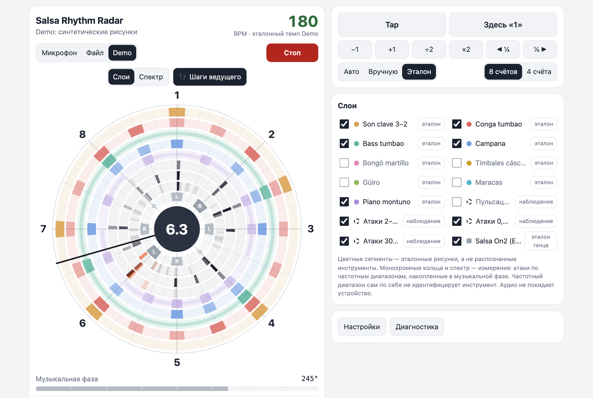

## Содержание

1. [Быстрый старт](#1-быстрый-старт)
2. [Экран приложения](#2-экран-приложения)
3. [Как читать циферблат](#3-как-читать-циферблат)
4. [Источники звука: Demo, Микрофон, Файл](#4-источники-звука)
5. [Темп и синхронизация](#5-темп-и-синхронизация)
6. [Слои и карточки слоёв](#6-слои-и-карточки-слоёв)
7. [Полярная спектрограмма](#7-полярная-спектрограмма)
8. [Настройки](#8-настройки)
9. [Диагностика](#9-диагностика)
10. [Установка на телефон, темы, полный экран](#10-установка-на-телефон-темы-полный-экран)
11. [Сценарии использования](#11-сценарии-использования)
12. [Что приложение умеет и чего не умеет](#12-что-приложение-умеет-и-чего-не-умеет)
13. [Вопросы и неполадки](#13-вопросы-и-неполадки)

---

## 1. Быстрый старт

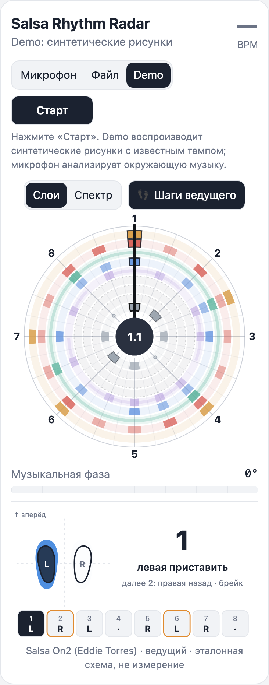

1. Откройте приложение. Без установки это адрес dev-сервера (`npm run dev` → http://localhost:5173) или опубликованная HTTPS-страница.
2. Выберите источник: **Demo** — синтетическая сальса с известным темпом, начать лучше с него; **Микрофон** — музыка вокруг; **Файл** — запись с устройства.
3. Нажмите **Старт** (для файла — **Выбрать аудиофайл**).
4. Подождите 6–10 секунд: в режиме «Микрофон» или «Файл» приложение ищет темп. Пока идёт поиск, вместо BPM написано «поиск темпа…».
5. Если стрелка проходит «1» не там, где в музыке начинается восьмёрка, нажмите **Здесь «1»** точно в момент счёта «раз».

Звук обрабатывается только на вашем устройстве и никуда не отправляется.

<br clear="right">

## 2. Экран приложения

На телефоне всё расположено в одну колонку, на компьютере — в две. Главная карточка с циферблатом на компьютере закреплена: настройки можно прокручивать, а циферблат остаётся на виду.

| Область | Что там |
|---|---|
| **Заголовок** | Название, текущий источник, крупное значение BPM и пояснение под ним: уверенность, «эталонный темп Demo» или «задан вручную» |
| **Источник и Старт/Стоп** | Переключатель Микрофон / Файл / Demo и главная кнопка |
| **Слои / Спектр** | Два вида циферблата: кольца рисунков или полярная спектрограмма |
| **Циферблат** | Восемь счетов, вращающаяся стрелка, в центре — текущий счёт |
| **Музыкальная фаза** | Положение внутри восьмёрки в градусах (полный круг = 360°) и полоса прогресса |
| **Инструменты темпа** | Tap, «Здесь 1», ±1 BPM, ÷2, ×2, сдвиг ¼, режим синхронизации, длина цикла |
| **Слои** | Список колец с переключателями и метками типа данных |
| **Настройки / Диагностика** | Параметры анализа и отображения, технические показатели |

## 3. Как читать циферблат

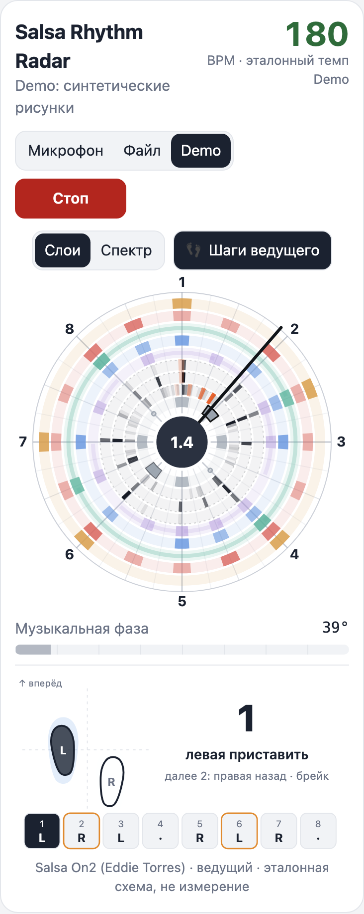

**Время идёт по кругу.** Один полный оборот — это одна восьмёрка (два такта 4/4):

- счёт «1» — сверху, время движется **по часовой стрелке**;
- один счёт — 45°, восьмая («и», «&») — 22,5°, шестнадцатая — 11,25°;
- жирные радиальные линии — счета, тонкие — восьмые, едва заметные — шестнадцатые.

**Стрелка** показывает текущий момент музыки. Её скорость задаёт темп, а положение — найденная (или заданная вами) фаза.

**Центр** показывает счёт в формате `счёт.шестнадцатая`: `6.1` — ровно на «шесть», `6.3` — на «шесть-и» (6&), `6.2` и `6.4` — промежуточные шестнадцатые.

### Три типа колец

Приложение никогда не смешивает то, что известно заранее, с тем, что измерено.

| Вид | Тип | Что означает |
|---|---|---|
| Цветные сегменты на бледной цветной дорожке | **эталон** | Документированный ритмический рисунок инструмента. Это **не** распознанный инструмент, а образец того, как он обычно играет |
| Монохромная тепловая полоса на пунктирной дорожке | **наблюдение** | Атаки (начала звуков), найденные в записи в своём частотном диапазоне и накопленные по восьмёркам |
| Серые блоки с буквами L/R внутри | **эталон танца** | Схема шагов выбранного стиля |

Детали эталонных колец:
- **Яркость сегмента** — относительная громкость удара. Например, у конги тихие «пятка/носок» бледнее, чем слэп и открытые тона.
- **Прозрачность** — достоверность источника: широко документированный рисунок ярче упрощённого или иллюстративного.
- **Бледный хвост** после сегмента — длительность звука (у баса, пианино, скрежета гуиро).
- **Обводка** — событие, которое звучит прямо сейчас, то есть стрелка внутри сегмента.

Детали колец наблюдения:
- Чем темнее (в тёмной теме — светлее) участок, тем чаще и сильнее в этой фазе восьмёрки появлялись атаки.
- **Короткие цветные вспышки** — атаки, найденные только что.
- **Прозрачность всего кольца** отражает уверенность синхронизации. Пока темп не найден, положение атак в круге ничего не значит, и кольцо почти прозрачное.

Детали кольца танца:
- **L / R** — левая или правая нога ведущего (если источник это однозначно указывает);
- **блок с обводкой** — брейк (смена направления), например «1» и «5» в On1 или «2» и «6» в On2;
- **кружок** — пауза (например, «4» и «8»).

<br clear="right">

### Как это выглядит в тёмной теме

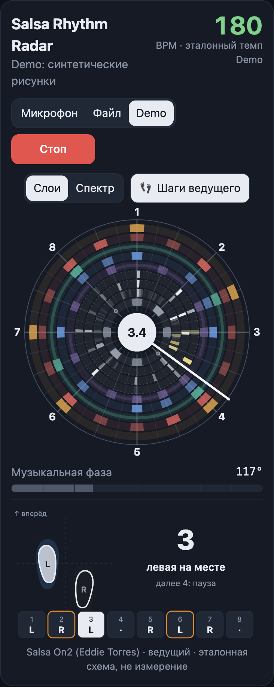

### Шаги ведущего

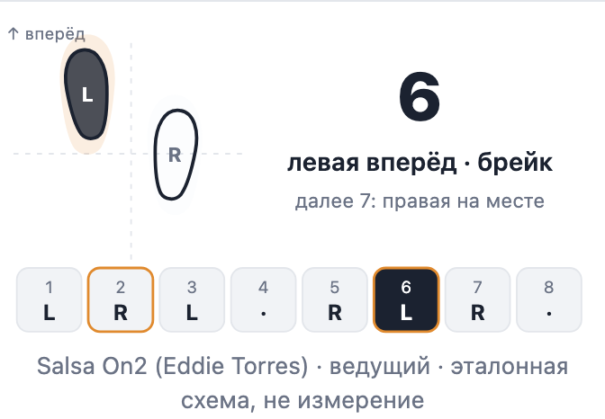

Кнопка **👣 Шаги ведущего** под переключателем «Слои / Спектр» показывает под циферблатом вид сверху на стопы ведущего в выбранной схеме. По умолчанию это **Salsa On2 (Eddie Torres)**.

- Стопа заранее движется к месту шага и **приземляется точно на счёт**. В момент постановки она вспыхивает (синим для шага, оранжевым для брейка) и плавно гаснет.
- **Закрашенная стопа** несёт вес, контурная свободна.
- Справа — номер счёта, текущее действие («правая назад · брейк») и следующий шаг.
- Внизу — восемь счётов с ногами: брейки (2 и 6 в ET On2) обведены, текущий счёт подсвечен, «·» — пауза.

Схема ET On2 для ведущего: 1 — левая приставить, **2 — правая назад (брейк)**, 3 — левая на месте, 4 — пауза, 5 — правая приставить, **6 — левая вперёд (брейк)**, 7 — правая на месте, 8 — пауза. Партнёрша зеркально.

Это эталонная схема, а не измерение движений: анимация идёт по тем же часам, что и стрелка.

<br clear="right">

### Цикл из четырёх счетов

Переключатель **8 счётов / 4 счёта** меняет длину оборота. В режиме 4 счётов один оборот — один такт (90° на счёт). Двухтактные рисунки (клаве, каскара) при этом накладываются сами на себя: оба такта видны на одном круге. Это удобно, чтобы сравнить «сторону 3» и «сторону 2» клаве.

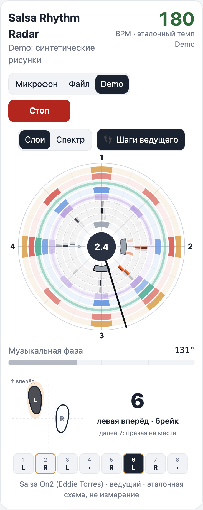

## 4. Источники звука

### Demo

Синтетическая сальса, которую приложение генерирует само. Темп и положение каждого удара известны точно, поэтому Demo годится и для обучения, и для проверки анализа.

- **Звучат видимые эталонные слои.** Включите в списке только клаве — услышите только клаве. Включите конгу и бас — услышите их вместе.
- Темп меняется в **Настройках → Demo → Темп** (80–240 BPM). Звук перестраивается без остановки, музыкальное время продолжается непрерывно.
- В **Настройках → Demo** можно добавить живости: случайные **временные отклонения** (микротайминг), **пропущенные удары** и **шум**. Так проверяется, насколько анализ устойчив к живой игре.
- По умолчанию стрелка в Demo идёт по **эталонному** (истинному) темпу. Переключите синхронизацию на **Авто**, чтобы посмотреть, как справляется автоматический анализ (см. раздел 5).

Голоса Demo — упрощённые синтетические звуки с правильными частотными областями и огибающими, а не записи реальных инструментов.

### Микрофон

Анализ музыки, звучащей рядом: в зале, из колонки, с другого телефона.

- Браузер спросит разрешение на микрофон — разрешите.
- Микрофон работает только на защищённой странице (**HTTPS**) или на `localhost`.
- Приложение отключает браузерное шумоподавление, эхоподавление и автоусиление: они разрушают атаки ударных.
- Положите телефон так, чтобы он хорошо слышал музыку, но не стоял вплотную к колонке (перегрузка ухудшает анализ). Уровень сигнала виден в **Диагностике → RMS**: разумно от −35 до −10 дБFS.
- Звук микрофона не воспроизводится через динамики, поэтому эха нет.

### Файл

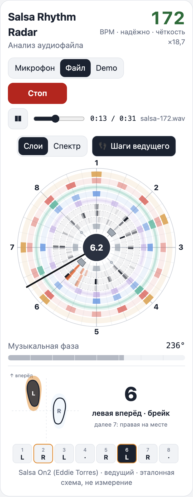

Анализ записи с устройства: MP3, WAV, M4A, OGG — всё, что умеет проигрывать ваш браузер.

1. Выберите **Файл** → **Выбрать аудиофайл**.
2. Воспроизведение начинается сразу. Под кнопкой появляется плеер: пауза, перемотка, время, имя файла.
3. При перемотке анализ начинается заново (темп ищется повторно, накопление сбрасывается).

На снимке справа — синтетическая запись на 172 BPM, о темпе которой приложению не сообщали: найдено 172 BPM.

Чтобы сделать свой тестовый файл с известным темпом:

```bash
npm run demo-wav -- my-test.wav 172 3-2 30   # темп 172, клаве 3–2, 30 секунд
```

<br clear="right">

## 5. Темп и синхронизация

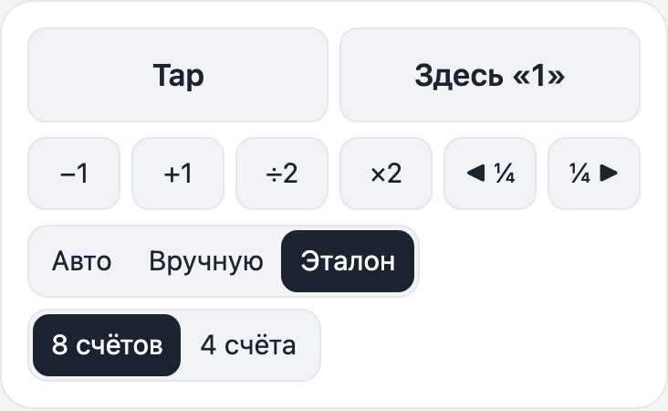

### Значение BPM в заголовке

| Подпись под числом | Значение |
|---|---|
| `поиск темпа…` | Автоматический анализ ещё не нашёл устойчивый темп (обычно 6–10 с) |
| `BPM · надёжно · чёткость ×8,2` | Темп найден автоматически. **Чёткость** — во сколько раз свёрнутый по восьмёркам ритм чётче случайного шума (1 = ритма нет). Уровень: **надёжно** (чёткость ≥ 6 и отрыв от второй гипотезы ≥ 1,6), **вероятно** (≥ 4 и ≥ 1,3), **неуверенно** (≥ 2,5, число жёлтым), **нет ритма** |
| `BPM · эталонный темп Demo` | Стрелку ведёт истинный темп синтезатора |
| `BPM · задан вручную` | Темп задан вами (Tap, ±1, ×2/÷2) |

### Режимы синхронизации

| Режим | Кто ведёт стрелку | Когда использовать |
|---|---|---|
| **Авто** | Анализ: находит темп и подстраивает фазу плавно, без скачков | Микрофон и файл |
| **Вручную** | Вы: стрелка идёт с заданным BPM и не подстраивается | Когда автоматика ошибается или нужна фиксированная сетка |
| **Эталон** | Истинный темп Demo (только в Demo) | Обучение; проверка точности анализа в Диагностике |

### Как приложение находит темп и «1»

Представьте ленту с записью, свёрнутую в трубку: если длина окружности равна длительности восьмёрки, удары разных восьмёрок ложатся друг на друга, и на торце проявляется рисунок. Приложение перебирает «диаметры» и выбирает тот, при котором рисунок самый чёткий одновременно на уровнях восьмёрки, такта, доли и восьмой. Так находится темп, обычно за 4 секунды.

Затем свёрнутый рисунок сравнивается со скелетом сальсы (конга-тумбао, бас-тумбао, колокол) с учётом выбранного направления клаве. Это определяет, где сильные доли (а не «и»), и где «1». Если музыка на сальсу не похожа, приложение определяет только доли.

### Кнопки

| Кнопка | Действие |
|---|---|
| **Tap** | Отстучите 3–8 раз ровно по счётам. Темп считается по интервалам нажатий, ближайшая доля привязывается к последнему нажатию. Пауза больше 2 секунд начинает отсчёт заново |
| **Здесь «1»** | Нажмите в момент счёта «раз»: циферблат плавно повернётся так, чтобы «1» оказалась на ближайшей доле. Накопленные данные поворачиваются вместе с ним и не теряются. Ручная «1» отключает автоматический поиск «1» (снова включается в настройках) |
| **−1 / +1** | Изменить темп на 1 BPM |
| **÷2 / ×2** | Половинный или двойной темп. В режиме Авто это ещё и переключает диапазон, в котором ищется темп |
| **◀ ¼ / ¼ ▶** | Сдвинуть циферблат на шестнадцатую (¼ доли) назад или вперёд. Два нажатия — половина доли |
| **8 счётов / 4 счёта** | Длина одного оборота |

Ручная правка темпа в режиме **Эталон** автоматически переключает синхронизацию на **Вручную**: иначе правка подделала бы истинный темп Demo.

### Типичные ситуации

| Что видно | Почему | Что делать |
|---|---|---|
| Темп вдвое меньше или больше ожидаемого (90 вместо 180) | 90 и 180 BPM описывают одну и ту же музыку на разных уровнях; приложение ищет темп в одном диапазоне (по умолчанию 120–240) | **×2** или **÷2** |
| 120 вместо 180 | В версии 0.2 на тестах не встречается: свёртка всей восьмёрки отличает долю от тресильо «3+3+2». Если всё же произошло, это видно в Диагностике по гипотезам | **Tap** или **+1/−1** |
| Стрелка проходит доли на «и» (на полдоли позже) | Бывает при сильных искажениях или когда звучат только бас и пианино: они почти целиком на слабых долях | Подождите несколько секунд (приложение переходит на долю, когда признаки устойчиво сильнее) или дважды нажмите **◀ ¼** / **¼ ▶** |
| «1» стоит не на начале восьмёрки | Автопоиск «1» опирается на скелет сальсы и на выбранное направление клаве. При неверном направлении (3–2 вместо 2–3) «1» окажется на «5» | Проверьте направление клаве в настройках или нажмите **Здесь «1»** на «раз» |
| Темп долго не находится | Тихо, нет выраженных ударных или очень свободный темп | Проверьте RMS в Диагностике; задайте темп через **Tap** |

## 6. Слои и карточки слоёв

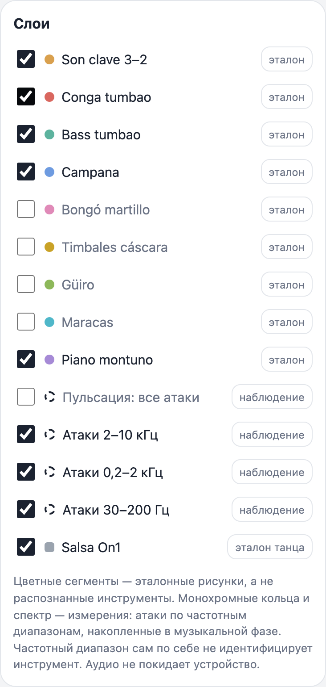

Галочка включает или выключает кольцо. Метка справа — тип данных: **эталон**, **наблюдение** или **эталон танца**. Нажатие на метку или на само кольцо циферблата открывает карточку слоя.

**Эталонные слои:** Clave (son или rumba, 3–2 или 2–3, выбирается в настройках), Conga tumbao, Bass tumbao, Campana, Bongó martillo, Timbales cáscara, Güiro, Maracas, Piano montuno.

**Слои наблюдения:**
- **Атаки 30–200 Гц** — низкие частоты: бас, низ конги, бас-барабан;
- **Атаки 0,2–2 кГц** — середина: конги, бонго, фортепиано, колокол;
- **Атаки 2–10 кГц** — верх: клаве, маракасы, гуиро, тарелки;
- **Пульсация: все атаки** — все диапазоны вместе.

Инструменты в скобках — лишь то, что *обычно* звучит в этом диапазоне. Атака в диапазоне не означает, что сыграл именно этот инструмент.

**Эталон танца:** схема, выбранная в настройках (Salsa On1, On2 (Eddie Torres), Casino, Son).

### Карточки

<table>
<tr>
<td>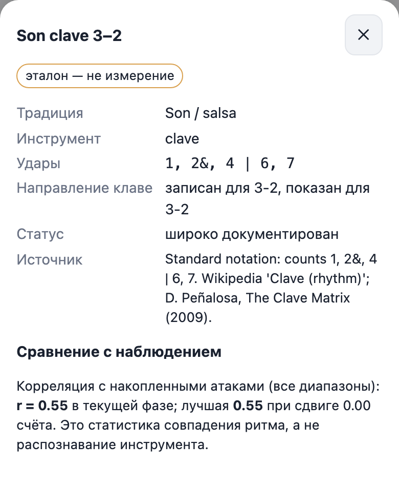</td>
<td>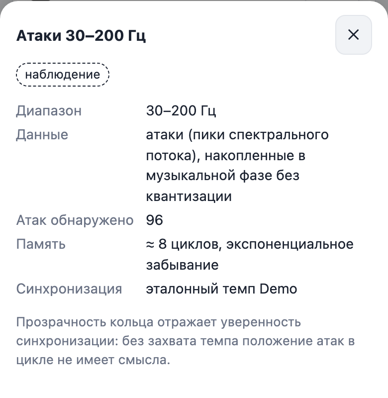</td>
<td>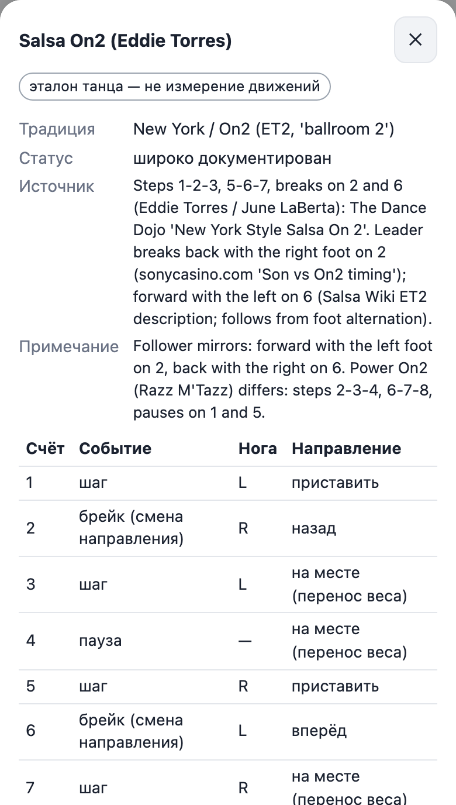</td>
</tr>
<tr>
<td>Эталон: удары по счетам, направление клаве, статус, источник</td>
<td>Наблюдение: диапазон, число атак, память, состояние синхронизации</td>
<td>Танец: таблица шагов — счёт, событие, нога, направление</td>
</tr>
</table>

**Сравнение с наблюдением** в карточке эталона — корреляция рисунка с накопленными атаками (от −1 до 1):
- **r в текущей фазе** — насколько эталон совпадает с услышанным при нынешнем положении «1»;
- **лучшее r и сдвиг** — при каком повороте совпадение максимально.

Если лучшее совпадение заметно выше текущего и сдвиг близок к целому числу счетов (например, 1,00), то «1» скорее всего стоит не там. Поверните циферблат на этот сдвиг кнопкой **Здесь «1»** или кнопками **¼**.

Это статистика совпадения ритма, а не распознавание инструмента. Похожий ритм могут дать разные инструменты.

## 7. Полярная спектрограмма

Переключите вид на **Спектр**.

### Идея

Обычная сонограмма показывает время по горизонтали и частоту по вертикали. Здесь сонограмма одной восьмёрки сворачивается в круг: **угол — фаза внутри восьмёрки, радиус — частота**.

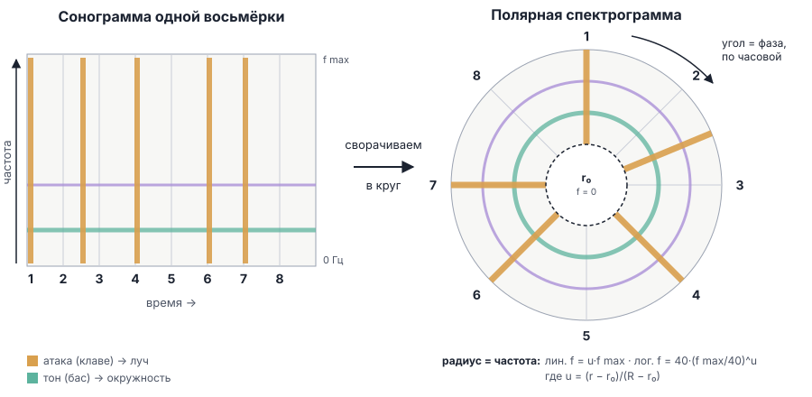

- **Атаки** (клаве, слэп конги) — короткие широкополосные звуки. Они дают **радиальные лучи** в своей фазе.
- **Тянущиеся тона** (бас, аккорды) дают **дуги и окружности** на своей частоте.
- Каждая новая восьмёрка ложится **на ту же картинку**, а старые восьмёрки постепенно гаснут (экспоненциальное забывание). Повторяющийся рисунок проступает ярче, а случайные звуки размываются.

Вокруг спектрограммы два тонких кольца-ориентира: эталон клаве и наблюдаемые атаки (отключаются в настройках).

### Три режима накопления

<table>
<tr>
<td>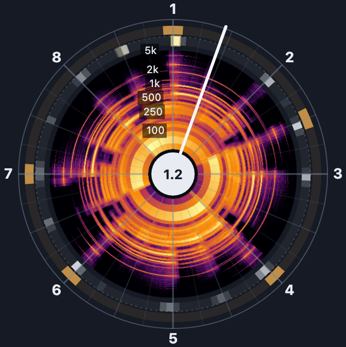</td>
<td>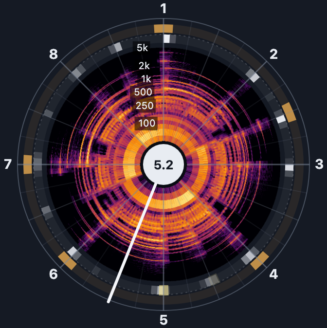</td>
<td>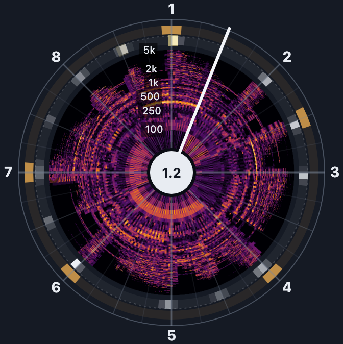</td>
</tr>
<tr>
<td><b>Мощность</b></td>
<td><b>Когерентное</b></td>
<td><b>Когерентность</b></td>
</tr>
</table>

Снимки сделаны на Demo с временными отклонениями 10 мс — как у живого музыканта.

- **Мощность** (по умолчанию). Усредняется энергия звука в одной и той же фазе восьмёрки. Показывает, *что и где звучит*, устойчиво к живой игре. Это основной режим.
- **Когерентное.** Усредняется сама форма звуковой волны, а не только её энергия. Остаётся лишь то, что повторяется из восьмёрки в восьмёрку *в точности так же*, а всё «гуляющее» гасит само себя. Для живой игры картинка тусклее, чем «Мощность». Для партий, повторяющихся с точностью до сэмпла (секвенсор, луп, сэмпл), — почти такая же.
- **Когерентность.** Отношение двух предыдущих режимов, от 0 до 1. Жёлтый — звук повторяется идентично, фиолетовый и тёмный — каждый раз по-разному. На снимке устойчивые атаки остаются когерентными, а гармоники баса и пианино, сдвинутые микротаймингом, — нет.

> Для исследователей. «Мощность» — некогерентное фазо-синхронное усреднение |X|². «Когерентное» — комплексное усреднение X с компенсацией дробного сдвига кадра. «Когерентность» — |ΣX|² / Σ|X|². Все три режима считаются одновременно, переключатель меняет только отображение. Подробнее — в [ARCHITECTURE.md](../ARCHITECTURE.md#6-накопление).

### Шкала частот и начало оси

<table>
<tr>
<td>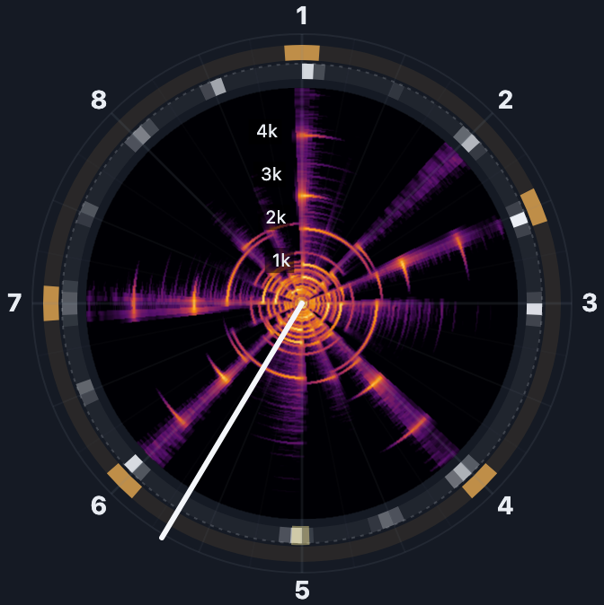</td>
<td>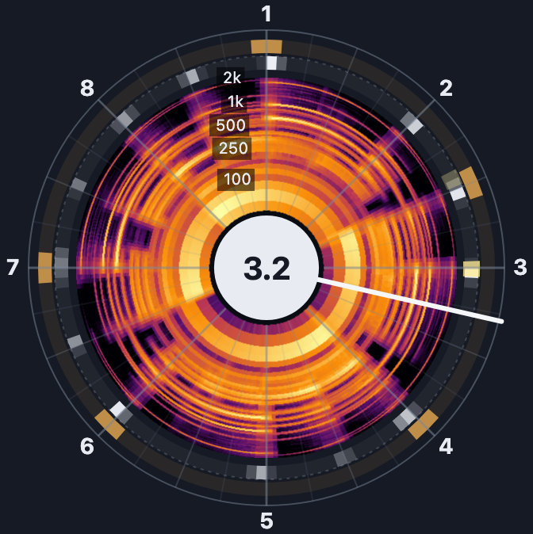</td>
</tr>
<tr>
<td>Линейная шкала, начало в центре (r₀ = 0), до 5 кГц</td>
<td>Логарифмическая шкала, r₀ = 30%, до 2 кГц</td>
</tr>
</table>

- **Линейная шкала:** одинаковые расстояния по радиусу означают одинаковое число герц. Хорошо видны высокочастотные атаки, а басовая область сжата у центра.
- **Логарифмическая шкала:** одинаковые расстояния означают одинаковые музыкальные интервалы (октавы). Бас, аккорды и мелодия занимают сопоставимое место. Начинается с 40 Гц.
- **Начало оси частот (r₀):** нулевая частота (на лог-шкале — 40 Гц) начинается не в центре круга, а на заданном радиусе — 0, 10, 20 или 30%. Центр не «сжимает» низкие частоты в точку, а внутри остаётся место для счёта.
- **Верхняя частота:** 2, 5 или 10 кГц. Её смена пересоздаёт картинку, и она заполняется заново за один оборот.
- **Динамический диапазон:** 40, 60 или 80 дБ — сколько тихих деталей показывать относительно самого громкого места.
- Подписи частот стоят вдоль луча чуть левее «1».

### Светлая тема

В светлой теме спектрограмма рисуется «чернилами» — тёмным по светлому, как печатная сонограмма.

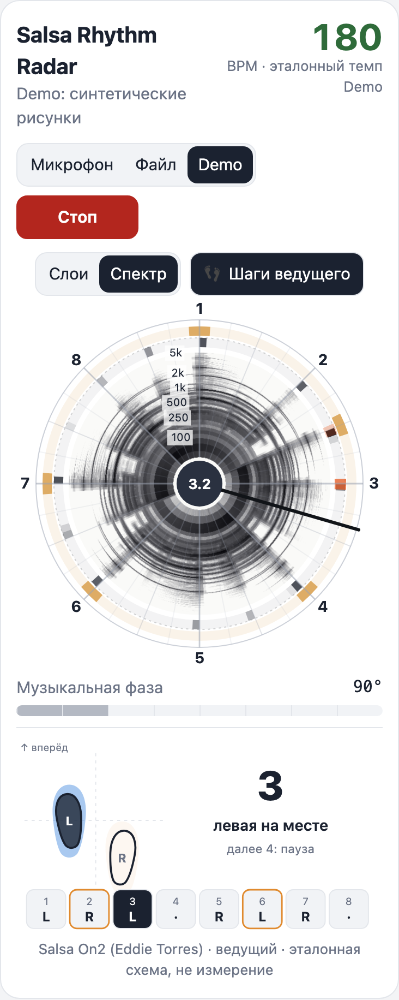

### Нажатие на спектрограмму

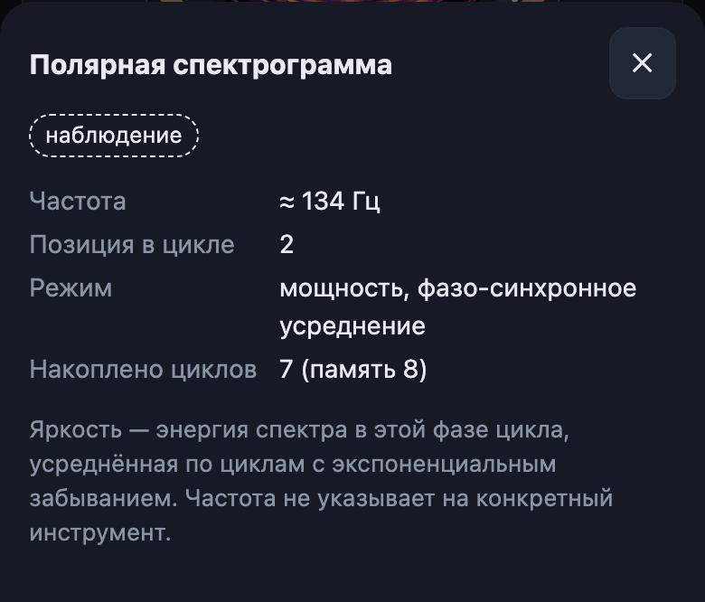

Нажмите в любую точку спектрограммы: карточка покажет частоту и позицию в восьмёрке, режим накопления и число накопленных циклов.

### Память и сброс

- **Накопление наблюдений** (в настройках) — сколько восьмёрок помнит радар: «Мгновенно» (только последняя восьмёрка), 4, 8, 16 или 32. Больше память — чище устойчивый рисунок, но медленнее реакция на изменения.
- **Накопленная картинка не стирается.** Приложение хранит не саму картинку, а «ленту» — историю звука за последние до 90 секунд — и несколько раз в секунду заново её сворачивает.
- **Как сворачивается лента — выбор в настройках («Лента при смене темпа»):**
  - **Перематывать** (по умолчанию) — вся история заново сворачивается текущим темпом и фазой. Когда темп уточняется, «1» сдвигается или меняется длина цикла, картинка плавно сжимается, растягивается и поворачивается, а рисунок проявляется чётче. Если музыка *действительно* сменила темп, старая часть ленты сначала размывается и постепенно уступает место новой.
  - **Фаза записи** — каждое наблюдение остаётся на той доле, которую ему дали часы в момент записи. Настоящая смена темпа ничего не размывает, но и прошлые ошибки синхронизации не исправляются. Повороты «1» применяются ко всей истории в обоих режимах.

<table>
<tr>
<td>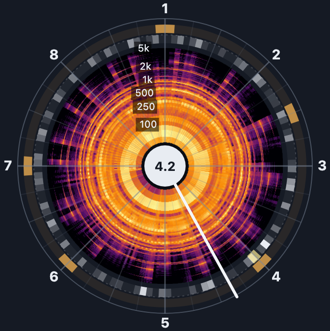</td>
<td>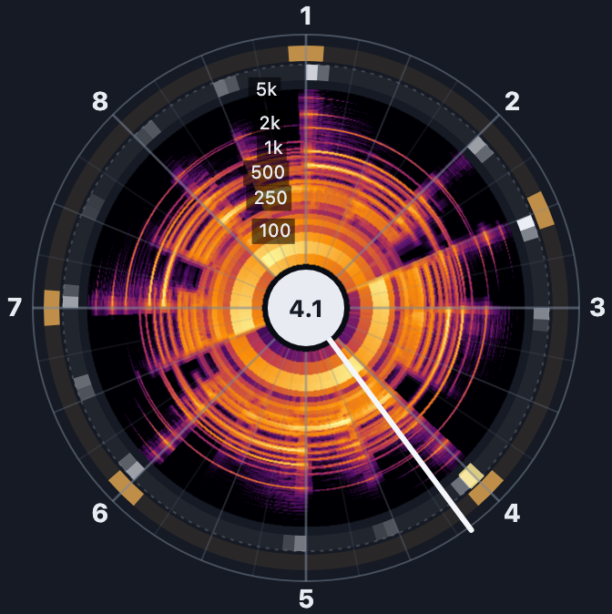</td>
</tr>
<tr>
<td>«Перематывать»: через 0,7 с после смены темпа Demo 180 → 165 старая часть ленты размыта</td>
<td>«Фаза записи»: та же ситуация, лучи атак остаются чёткими</td>
</tr>
</table>
- **Сбросить накопление** — очистить ленту, спектрограмму и кольца наблюдения.
- Тишина (тише −80 дБFS) не накапливается: пауза в музыке не стирает выученный рисунок.
- Сразу после старта воспроизведения у «1» может остаться полоса пониженной когерентности: первая восьмёрка началась с тишины и отличается от следующих. Полоса гаснет за несколько восьмёрок.

## 8. Настройки

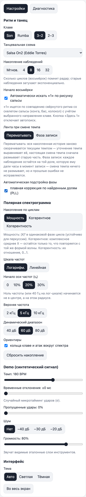

**Ритм и танец**
| Параметр | Варианты |
|---|---|
| Клаве | Son или Rumba; 3–2 или 2–3. Рисунки, зависящие от клаве (каскара, колокол, монтуно), поворачиваются вместе с выбором |
| Танцевальная схема | Salsa On2 (Eddie Torres) — по умолчанию, Salsa On1, Casino, Son (contratiempo) |
| Начало восьмёрки | Автоматически искать «1» по рисунку сальсы (включено по умолчанию) |
| Лента при смене темпа | «Перематывать» (по умолчанию) или «Фаза записи» — см. раздел 7 |
| Накопление наблюдений | Мгновенно / 4 / 8 / 16 / 32 восьмёрки |
| Автоматическая подстройка фазы | Плавная коррекция стрелки по найденным долям (в режиме Авто) |

**Полярная спектрограмма** — режим накопления, шкала частот, r₀, верхняя частота, динамический диапазон, кольца-ориентиры, кнопка сброса (раздел 7).

**Demo**
| Параметр | Смысл |
|---|---|
| Темп | 80–240 BPM |
| Временные отклонения | Случайный сдвиг каждого удара (стандартное отклонение, 0–25 мс) |
| Пропущенные удары | Доля случайно выпавших ударов (0–40%) |
| Шум | Белый шум −40 / −30 / −20 дБ |
| Громкость | Громкость Demo |

**Интерфейс** — тема (авто / светлая / тёмная) и полноэкранный режим.

Настройки сохраняются в браузере и восстанавливаются при следующем запуске.

<br clear="right">

## 9. Диагностика

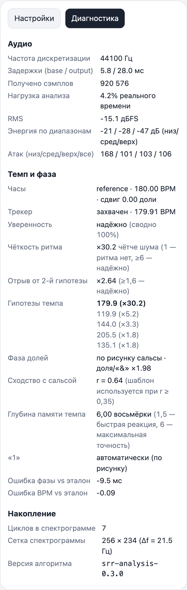

Раздел для тех, кто хочет понимать, насколько можно доверять тому, что показано.

**Аудио**
- **Частота дискретизации, задержки:** параметры звуковой системы устройства.
- **Нагрузка анализа:** доля реального времени, которую занимает анализ (обычно около 1%).
- **RMS:** общий уровень сигнала.
- **Энергия по диапазонам:** низ, середина и верх в дБ.
- **Атак:** сколько атак найдено в каждом диапазоне.

**Темп и фаза**
- **Часы:** кто ведёт стрелку (`auto`, `manual`, `reference`), темп и поворот «1».
- **Трекер:** найден ли темп и какой. Трекер работает всегда, даже когда стрелку ведёт эталон или ручной режим.
- **Уверенность:** словесный уровень (надёжно / вероятно / неуверенно / нет ритма).
- **Чёткость ритма:** во сколько раз свёрнутый по восьмёркам ритм чётче шума. 1 — ритма нет, 6 и больше — надёжно.
- **Отрыв от 2-й гипотезы:** во сколько раз лучшая гипотеза темпа сильнее следующей. Около 1 — музыка неоднозначна, 1,6 и больше — надёжно.
- **Гипотезы темпа:** найденные темпы с их чёткостью. Например, «180 (×21), 120 (×9)»: 120 — это прочтение тресильо, и оно заметно слабее.
- **Фаза долей:** чем определялась фаза — «по рисунку сальсы» или нейтральной «гребёнкой долей», и во сколько раз доля сильнее «и».
- **Сходство с сальсой:** корреляция свёрнутого рисунка со скелетом сальсы. Шаблон используется при r ≥ 0,35.
- **Глубина памяти темпа:** сколько восьмёрок накладывается для уточнения темпа. Пока ритм стабилен, растёт до 6 (точнее); при смене темпа сжимается до 1,5 (быстрее реакция).
- **«1»:** найдена автоматически, задана вручную или автопоиск выключен.
- **Ошибка фазы / BPM относительно эталона** (только Demo в режиме «Эталон»): насколько автоматический анализ расходится с истиной. Хороший результат — единицы миллисекунд.

**Накопление** — число накопленных восьмёрок, размер сетки спектрограммы, версия алгоритма.

<br clear="right">

## 10. Установка на телефон, темы, полный экран

- **Установка:** откройте приложение по HTTPS в Chrome (Android) или Safari (iOS) и выберите «Добавить на главный экран» / «Установить приложение». Приложение откроется без адресной строки.
- **Офлайн:** после первой загрузки по сети приложение работает без интернета (кроме режима «Файл», если файл лежит в облаке).
- **Тема:** в настройках — авто (как в системе), светлая или тёмная.
- **Полный экран:** кнопка «Во весь экран» в настройках.

## 11. Сценарии использования

### Танцору: услышать клаве и свой шаг
1. Demo, включите только **Clave** и **Танец**, темп 140–160.
2. Сравните, на какие счета приходятся удары клаве (3–2: 1, 2&, 4 | 6, 7) и ваши шаги (On1: брейк на 1 и 5, паузы на 4 и 8).
3. Переключите схему на **On2**: брейк уходит на 2 и 6.
4. Переключите клаве на **2–3** и посмотрите, как меняется отношение ударов к шагам.

### Танцору: найти «раз» в реальной песне
1. **Микрофон** или **Файл**, подождите, пока темп будет найден.
2. Слушайте и нажмите **Здесь «1»** на «раз».
3. Откройте карточку **Clave**: если лучший сдвиг ≠ 0, «1» можно поправить.

### Преподавателю: объяснить полиритмию по слоям
1. Demo, включите только **Clave**, затем добавляйте по одному: **Conga**, **Bass**, **Campana**, **Piano**.
2. Каждый слой одновременно звучит и подсвечивается в момент удара.
3. Режим **4 счёта** показывает, чем «сторона 3» отличается от «стороны 2».

### Музыканту: проверить ровность игры
1. Запишите свою партию на фоне метронома или клика, загрузите в **Файл**.
2. Вид **Спектр**, режим **Когерентность**, память 16–32.
3. Яркие (жёлтые) участки — удары, которые вы повторяете очень точно; тёмные — те, что «гуляют».
4. Для сравнения откройте Demo и добавьте **временные отклонения** 5, 10, 20 мс: так выглядит известная степень неточности.

### Исследователю: проверить анализ
1. Demo, режим синхронизации **Авто**, откройте **Диагностику**.
2. Добавляйте отклонения, пропуски и шум и следите за ошибкой фазы и гипотезами темпа.
3. Воспроизводимые метрики — `npm run bench`, результаты и находки — в [EXPERIMENTS.md](EXPERIMENTS.md).

## 12. Что приложение умеет и чего не умеет

**Умеет**
- Находить темп сальсы примерно за 4 секунды (проверено на синтетике 140–220 BPM, включая клаве без других инструментов: ошибка ≤ 0,03 BPM, фаза ±2–5 мс).
- Находить «1» по рисунку сальсы.
- Плавно синхронизировать стрелку без скачков; накопленная картинка следует за темпом и не стирается.
- Показывать анимацию шагов ведущего (ET On2 и другие схемы).
- Следовать за сменой темпа внутри трека: новый темп принимается примерно за 4 секунды.
- Показывать, *где* в восьмёрке и *в каком частотном диапазоне* появляются атаки.
- Накапливать полярную спектрограмму по восьмёркам в трёх режимах.
- Сравнивать эталонный рисунок с накопленными атаками.

**Не умеет (пока)**
- **Распознавать инструменты.** Цветные кольца — эталоны, а не обнаруженные конга или клаве. Атака в диапазоне 200–2000 Гц может быть чем угодно.
- **Определять направление клаве** (3–2 или 2–3) по записи.
- **Компенсировать задержку микрофона:** в режиме «Микрофон» стрелка может отставать на 10–40 мс.
- **Записывать сессии и экспортировать данные** — в плане ([ROADMAP.md](../ROADMAP.md)).
- **Работать с датчиками движения** (Salsa Motion Lab) — в плане.

Приложение пока проверено на синтетических сигналах и в Chrome на компьютере. Проверка на реальных записях и телефонах впереди.

## 13. Вопросы и неполадки

**Нажимаю «Старт» с микрофоном — ошибка доступа.**
Разрешите микрофон в настройках сайта в браузере. Страница должна открываться по HTTPS (или с `localhost`).

**Темп не находится.**
Посмотрите **RMS** в Диагностике: если ниже −45 дБFS, сигнал слишком тихий. Попробуйте ближе к источнику или задайте темп через **Tap**.

**Что значит «чёткость ×8» и «неуверенно»?**
Чёткость показывает, во сколько раз свёрнутый по восьмёркам ритм чётче случайного шума. Для сальсы с выраженной перкуссией типично ×8–20. При «неуверенно» (жёлтое число) стоит проверить уровень сигнала или задать темп вручную.

**Темп скачет между двумя значениями.**
Откройте Диагностику → Гипотезы темпа: если оценки близки (отрыв меньше 1,3), музыка неоднозначна. Переключитесь в режим **Вручную** и задайте темп через **Tap**.

**Кольца наблюдения почти прозрачные.**
Темп ещё не найден (режим Авто). Пока синхронизации нет, положение атак в восьмёрке не имеет смысла, поэтому приложение их не подчёркивает.

**Спектрограмма после смены настроек частично пустая.**
Смена верхней частоты, длины цикла или темпа пересоздаёт накопление. Картинка заполнится за один оборот.

**Звука Demo нет.**
Проверьте громкость устройства и **Настройки → Demo → Громкость**. В Demo звучат только *включённые эталонные* слои.

**Приложение тормозит на телефоне.**
Уменьшите верхнюю частоту спектрограммы до 2 кГц и отключите лишние слои. Если возможно, сообщите модель устройства — это поможет в доработке.

---

См. также: [README](../README.md) · [Архитектура](../ARCHITECTURE.md) · [План](../ROADMAP.md) · [Эталоны и источники](PATTERNS.md) · [Эксперименты](EXPERIMENTS.md)
